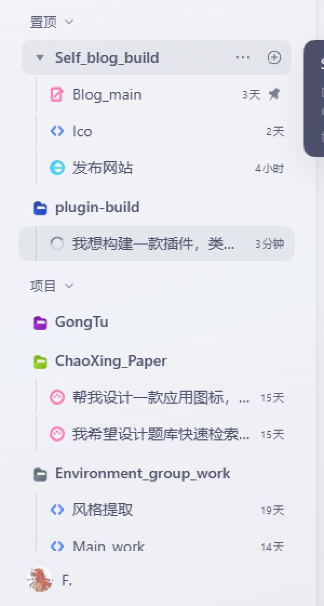

# Sidebar icons for DeepSeek Harness

一套给 **DeepSeek Harness** 左侧栏用的黏土质感（Claymorphism）3D 图标插件：21 个项目文件夹图标 +
28 个会话图标，同一套光影；每一行都能从它自己的 `⋯` 菜单换成任意一个图标。**当前版本 v1.0.3**。

> 只想装上用？看 **[INSTALL.md](INSTALL.md)**（解压 → 放进 node_modules → 插件管理里启用）。



---

## 功能

| | |
|---|---|
| **21 个项目图标** | 黏土文件夹（大圆角本体 + 左上标签页 + 奶油白纸页），按项目名自动匹配色相，色相环上排开，21 种互不撞色 |
| **28 个会话图标** | 面板里是黏土小物体（烧瓶、地球、盾牌、手柄、气泡…），**侧栏 16px 行里换成同一套语义的粗线字形**，按会话标题自动匹配，分 6 个功能色系 |
| **逐行自定义** | 项目/会话的 `⋯` 菜单里都有 **自定义图标…**，面板里 3×7 / 4×7 直接点选，立即生效并记在本机 |
| **层级缩进** | 会话行相对所属项目右移 16px，并有一条跟随主题的细引导线；多层嵌套按层级递增 |
| **不打扰宿主** | 只往行里追加自己的节点 / 属性，关掉插件时全部还原；不改官方文案、类名和事件 |

> 悬停时左侧图标照常显示，右侧出现 ⋯ / 归档 / 置顶 三个操作；收藏入口在 ⋯ 菜单第一项。

---

## 安装

这是 DeepSeek Harness 的 **bundle 插件**（含 `cordis.patch.yml` 与 `package.json` 的 `dsh.bundle` +
`dsh.client` 字段），把整个目录挂到你的 profile 即可。

### 方式一：链接到 profile（开发时推荐）

```powershell
# 1. 把本目录放到任意位置，然后建立软链（Windows 需管理员或开发者模式）
New-Item -ItemType SymbolicLink `
  -Path   "$env:USERPROFILE\.dsh\profiles\desktop\node_modules\dsh-sidebar-icons" `
  -Target "<本目录的绝对路径>"

# 2. 在 profile 的 cordis.patch.yml 里插入一行
#    - insert:
#        - id: sidebar-icons
#          name: dsh-sidebar-icons
```

### 方式二：复制进 profile

```powershell
Copy-Item "<本目录>" "$env:USERPROFILE\.dsh\profiles\desktop\node_modules\dsh-sidebar-icons" -Recurse
```

然后在 DSH 的**设置 → 插件**里启用 `dsh-sidebar-icons`（或对 bundle 开关一次），
侧栏会立刻换成黏土图标。

> 改动 `client.js` 之后，插件管理里把 bundle **关 → 开** 一次即可热重载；
> 若样式看着没更新，刷新一次窗口（Ctrl+R）。

---

## 使用

> 完整使用说明（自动匹配表、恢复默认、故障排查、卸载）见 **[docs/USAGE.md](docs/USAGE.md)**。

1. **自动**：新建项目 / 会话，图标按名称自动匹配（`api-*` → 接口、`fix-*` → 修复、
   `release-*` → 发布…），规则见 `docs/DETAIL.md` 的「The kind table」。
2. **手动**：项目或会话行 `⋯` → **自定义图标…** → 点一个 → 完成。
   - 项目面板是 21 个纯色块（3×7，名称在悬停提示里）；
   - 会话面板是 28 个带英文名的小图标（4×7）。
3. **恢复默认**：面板左下角 **Use default**（有自定义时才出现），回到按名称匹配。
4. 选择存在浏览器 `localStorage` 的 `dsh-sidebar-icons:overrides`，不随会话同步、不影响会话日志。

---

## 设计规范（想自己加图标时看这段）

**画布** 128 × 128，图标本身就是一块物体，没有外层容器或底板；主体占 70–78%，所有转角大圆角
（≈ 主体宽度的 18–20%）。

**光影** 全套共用一套，改一处即全变：地面椭圆投影（深色 25% + 模糊 7）→ 三段渐变主体
（亮 → 主色 35% → 暗）→ 轮廓内下移 6 的深色内阴影 38% → 左上白色径向亮面 40% → 轮廓内缘 3 宽的
浅色反光 45%。**尺寸分档**：会话图标 ≤20px 走 **16 画布的粗线字形**（笔画 2.2、2–4 段路径、占 86% 画布、用所属色系主色），
≥21px 画完整黏土五层；项目文件夹在行里固定 16px，走「渐变主体 + 内缘反光 + 奶油白纸页」的简化档。

**会话 6 个色系**（项目则用 kind 自己的色相，亮暗由色相推出，保证 21 色不撞）：

| 色系 | 成员 | main / light / dark |
|---|---|---|
| dev | Code · API · Git · Terminal · Deploy | `#5B8CFF` / `#7FA3FF` / `#3A5FD9` |
| smart | AI · Research · Lab · Study | `#A06BFF` / `#B78CFF` / `#7A45E0` |
| quality | Test · Security · Perf | `#3DDC97` / `#63E7AE` / `#1FAF72` |
| alert | Bug | `#FF6B7A` / `#FF8A96` / `#D94456` |
| create | Design · Media · Blog · Docs · Note | `#FF7EB6` / `#FF9BC7` / `#E0518C` |
| ops | Business · Plan · Data · Infra · Sync | `#FFB347` / `#FFC46B` / `#E8862A` |
| sky | Web · Mobile · Game · Chat | `#43CFF2` / `#6FDCF7` / `#1FA5CC` |
| neutral | Other | `#B9C2D0` / `#C9D0DC` / `#8E98A8` |

> 完整的几何、分类规则表、限制清单在 **[docs/DETAIL.md](docs/DETAIL.md)**（英文）；这一节只留概述。
### 加一个会话图标（三步）

1. `CLAY` 里加一条：`foo: { fam: 'dev', parts: [{ d: '<path>' }], accent: [{ d: '<path>' }] }`；
2. `SESSION_KINDS` 里加 `'foo'`（位置即面板里的顺序，注意与相邻色相拉开）；
3. `KIND_LABELS` 里加 `foo: ['中文', 'Foo']`，需要自动匹配的话再往 `SESSION_RULES` 加关键词。

路径一律画在 128 格内、用填充（`w` 是描边宽度，留空就是填充），不要加外描边——
体积感全部交给上面那套光影。

---

## 目录结构

```
dsh-sidebar-icons/
├─ client.js            # 全部客户端逻辑：图标几何、渲染、选图面板、菜单注册、装饰 CSS
├─ index.js             # Host 半边（本插件不注册 host 能力，留空实现）
├─ package.json         # dsh.bundle / dsh.client 声明、版本、npm run check
├─ cordis.patch.yml     # bundle 往 profile 里插入自己
├─ icon.svg             # 插件列表里显示的那个图标
├─ README.md            # 本文档
├─ INSTALL.md           # 三步安装说明（下载安装包的人先看这个）
├─ LICENSE              # MIT
├─ .gitignore
├─ locale/
│  ├─ zh.json           # 插件列表用的中文元数据（title / description / detail）
│  └─ en.json
├─ scripts/
│  └─ check.mjs         # 零依赖自检：三表一致 / 规则重复 / 渲染冒烟 / 版本与文案
├─ .github/workflows/
│  └─ check.yml         # 每次 push 跑 scripts/check.mjs + node --check
└─ docs/
   ├─ USAGE.md          # 使用文档：自动匹配表、自定义流程、故障排查、卸载
   ├─ DETAIL.md         # 设计文档（英文）：几何、光影参数、色板、分类规则、限制
   ├─ CHANGELOG.md      # 版本记录
   └─ images/
      └─ sidebar.png    # README 顶部的截图
```

**运行时只需要这些**：`package.json`、`index.js`、`client.js`、`cordis.patch.yml`、`icon.svg`、`locale/*.json`。
其余的文档、自检脚本、CI 配置都不参与运行 —— Release 里的 `-install.zip` 就是「运行所需 + 文档」的精简版，
`-source.zip` / GitHub 自动生成的 Source code 则是完整仓库。

---

## 自检

```bash
node scripts/check.mjs      # 或 npm run check
```

零依赖，检查：三张表（`CLAY` / `SESSION_KINDS` / `KIND_LABELS`）是否一一对应、规则表有没有重复 kind、
每种会话图标是否有 16px 专用字形、两个尺寸下能否渲染（以及尺寸分档对不对）、
`package.json` 与 `CHANGELOG` 版本是否一致、`WORDS` 中英是否同键、locale 元数据是否完整。
CI（`.github/workflows/check.yml`）在每次 push 时跑同一套。
## 已知限制

- 会话图标只在该行状态为 **idle** 时显示：运行中 / 等待回答 / 未读完成 时，那个格子仍是官方的
  状态点；已归档行保持空白（官方行为）。
- 16px 行里用的是**为小尺寸单独画的粗线字形**，不是把面板里那套黏土物体缩下来 ——
  所以行内的图标与面板里的预览"同语义但不同形"，这是有意的取舍。
- 自定义图标存在本机 `localStorage`，不跟随会话同步到别的设备。
- 项目行的文件夹图标依赖官方行结构（`[data-sidebar-list-area]` + `[data-row-key^="workspace:"]`）；
  若未来的 DSH 改了行结构，装饰会找不到锚点、在控制台告警一次并退回官方图标（不会弄坏行）。
- 缩进 / 引导线 / 隐藏收藏星标这三段 CSS 是针对当前官方行结构与
  `@michengai/dsh-archive-manager` 的 DOM 写的；对应宿主或该插件大改时需要复核对位。
- `package.json` 里的 `"private": true` 是为了防止误 `npm publish` —— **不影响**按目录安装进 DSH。
  如果你希望别人能 `npm install`，删掉这个字段再发布即可。

## 版本

当前 **v1.0.3**。版本记录见 [docs/CHANGELOG.md](docs/CHANGELOG.md)。

---

## English

### What it is

A Claymorphism icon set for the **DeepSeek Harness** sidebar: **21 clay folders** for Workspace rows
and **28 clay objects** for Session rows, all sharing one light source, one shadow height and one
rounding rule.

In the picker a Session icon is a 128-canvas clay object; in the 16px sidebar row it is replaced by a
**bold glyph of the same meaning**, drawn for that size (2–4 paths, 2.2 stroke, 86% of the canvas) —
a clay object scaled to 16px just reads as a coloured dot.

### Install

1. Download `dsh-sidebar-icons-v1.0.0-install.zip` from the Releases page and unzip it.
2. Move the `dsh-sidebar-icons` folder into your profile's `node_modules`:
   - Windows `C:\Users\<you>\.dsh\profiles\desktop\node_modules\`
   - macOS / Linux `~/.dsh/profiles/desktop/node_modules/`
3. In DSH open **Settings → Plugins**, enable `dsh-sidebar-icons`. Refresh (Ctrl+R) if the sidebar
   looks unchanged.

More detail, including troubleshooting and uninstall, in [INSTALL.md](INSTALL.md).

### Use

- Icons are matched from names automatically (see the rules table in [docs/DETAIL.md](docs/DETAIL.md)).
- Override any single row: its `⋯` menu → **Custom icon…** → pick one. The choice is stored per row in
  `localStorage` and never touches your session log or the Workspace registry.
- A new project never repeats the colour of the project above it.
- Session rows are indented 16px under their project with a theme-aware hairline guide; nested
  Workspaces add the host's own per-level indent on top of that.
- The archive plugin's favourite star is hidden from the row (it stays available in the `⋯` menu), so
  the leading icon is always visible.

### Limitations

- A Session row shows its icon only while that row is **idle**; running / awaiting / unread-complete
  rows keep the official status dot, and archived rows keep the cell empty.
- Custom choices live in this browser's `localStorage` — they do not travel with the Session.
- The folder mark depends on the shipped row markup (`[data-sidebar-list-area]`,
  `[data-row-key^="workspace:"]`). If a future DSH release changes it, the decoration warns once in
  the console and leaves the official icon in place.
- Indent, guide line and the hidden favourite star are CSS written against the current row markup and
  `@michengai/dsh-archive-manager`'s DOM; a major change on either side needs a re-check.

### Design notes

Body occupies 70–78% of a 128 canvas, every corner is rounded (≈18–20% of the body width), and the
same five layers are used everywhere: ground shadow → three-stop body gradient → inner shadow →
top light → rim light, plus at most one cream accent. Full parameters and the colour table are in
[docs/DETAIL.md](docs/DETAIL.md).

## License

MIT — see [LICENSE](LICENSE).